### [[English Document]](README_EN.md)

# 🎨 智爱 ComfyUI 节点包 

<p align="center">
  
</p>

## 📖 项目介绍

这是一个由 **Binity** 精心创建的 ComfyUI 自定义节点工具合集，旨在为用户提供一系列实用、高效的节点，以增强和扩展 ComfyUI 的功能。本节点集包含55个功能节点，涵盖文本处理、提示词优化、图像处理、翻译工具、音乐创作辅助、AI视觉理解、Latent处理等多个方面，为您的 AI 创作提供全方位支持。

***如果这个项目对您有帮助，请给我们一个⭐Star！您的支持是我们持续改进的动力。***

## ✨ 主要特点

### 🌍 **中英双语支持（内置）**
节点包自带中英双语词典，跟随 ComfyUI 的「语言 / Language」设置自动切换节点语言，无需安装任何第三方翻译插件。

### **核心功能特色**

- 🔄 **多引擎翻译节点**：集成百度、阿里云、有道、智谱AI与谷歌在线共5大翻译平台，支持中英互译，可自动识别输入语言，自由切换翻译平台。

- 📝 **全面文本处理**：提供多行文本编辑、文本合并分离、内容提取修改、语言过滤等文本操作节点。

- 🎯 **智能提示词系统**：标签选择器、图像编辑预设、摄影提示词生成器、万相视频提示词生成器等专业的提示词生成工具。

- 🖼️ **实用图像工具**：支持多算法图像缩放、智能切换、颜色移除等等。

## ⭐ 明星节点

🔥 **<span style="color: #FF6B35; font-weight: bold; font-size: 1.1em;">以下是本节点集中重点推荐的特色节点：</span>**

<table>
<tr>
<th width="30%">节点名称</th>
<th width="19%">类别</th>
<th width="51%">核心功能</th>
</tr>
<tr>
<td><b>标签选择器</b><br><code>TagSelector</code></td>
<td>提示词处理</td>
<td>新一代智能标签管理系统，集成海量预设标签库、自定义标签管理、角色提取器和内置AI扩写功能。提供可视化标签选择界面，支持随机标签生成和多模式扩写。</td>
</tr>
<tr>
<td><b>摄影提示词生成器</b><br><code>PhotographPromptGenerator</code></td>
<td>提示词处理</td>
<td>专业摄影风格提示词生成器，涵盖人物、场景、镜头、光线、服装等32个维度。支持标签组合与模板文本两种输出模式，可随机选择增加创意多样性。配有用户自定义选项扩展和模板编辑助手界面。</td>
</tr>
<tr>
<td><b>LM Studio节点</b><br><code>LMStudioNode</code></td>
<td>AI 助手</td>
<td>连接本地LM Studio服务器的视觉理解节点，支持图像分析和文本生成。通过LM Studio本地部署的大模型，实现无需云端API的私有化图像分析。支持多种预设模板、输出语言控制和多图像输入。</td>
</tr>
<tr>
<td><b>图像理解在线版</b><br><code>ImageUnderstandingOnline</code></td>
<td>AI 助手</td>
<td>通过任意 OpenAI 兼容的在线多模态接口进行图像理解，无需本地GPU，可预设最多 6 套平台配置并在节点下拉菜单中直接切换。支持单图与多图输入、文本提示词端口整段接管、未接图像时作为纯文本节点调用，并与 LM Studio 节点共用提示词模板分类与批处理能力。</td>
</tr>
</table>

💡 **使用建议**：新用户建议从 **标签选择器** 或 **摄影提示词生成器** 开始体验，快速提升您的创作灵感和效率。

---

## 🛠️ 节点功能说明

本节点集包含众多功能各异的节点，分为以下几个主要类别：

### 📝 文本处理类节点

<table>
<tr>
<th width="30%">节点名称</th>
<th>功能描述</th>
</tr>
<tr>
<td><b>多行文本</b><br><code>MultiLineTextNode</code></td>
<td>提供一个支持多行输入的文本框，并带注释功能。

<br>
<div align="left">
<a href="images/多行文本.jpg" target="_blank">
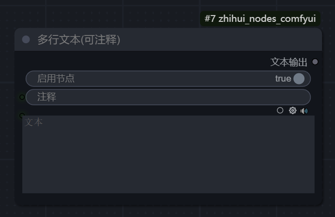
</a>
</div></td>
</tr>
<tr>
<td><b>提示词合并器(可注释)</b><br><code>TextCombinerNode</code></td>
<td>合并两个文本输入，并可通过独立的开关控制每个文本的输出，并带注释功能。可用于动态组合不同的提示词部分，灵活构建完整提示。

<br>
<div align="left">
<a href="images/提示词合并器.jpg" target="_blank">
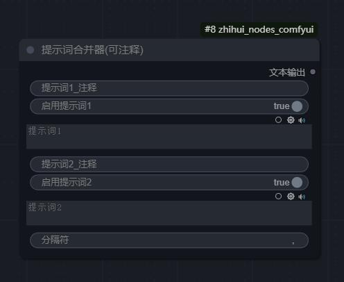
</a>
</div></td>
</tr>
<tr>
<td><b>文本合并器</b><br><code>TextMergerNode</code></td>
<td>将多个文本输入合并为一个输出文本，支持灵活配置输入端口数量。<b>user_text</b> 输入框内容优先显示在最前面，后续通过 <b>inputcount</b> 滑块控制 <b>text_2</b> 到 <b>text_N</b> 端口数量。所有非空文本按顺序用分隔符连接，适用于批量合并多个提示词或文本片段。

<br>
<div align="left">
<a href="images/Text Merger Node.png" target="_blank">

</a>
</div></td>
</tr>
<tr>
<td><b>文本修改器</b><br><code>TextModifier</code></td>
<td>根据指定的起始和结束标记提取文本内容，并自动去除多余的空白字符。适合从复杂文本中提取特定部分，或进行格式清理。

<br>
<div align="left">
<a href="images/Text Modifier.jpg" target="_blank">

</a>
</div></td>
</tr>
<tr>
<td><b>中英文本提取器</b><br><code>TextExtractor</code></td>
<td>从混合文本中提取纯中文或纯英文字符，支持标点和数字的提取，并自动清理格式。对于处理双语提示词或分离不同语言内容非常有用。<br><br>
<div align="left">
<a href="images/中英文本提取器.jpg" target="_blank">
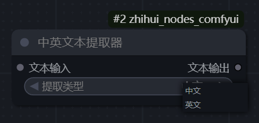
</a>
</div></td>
</tr>
<tr>
<td><b>提示词删除</b><br><code>PromptDelete</code></td>
<td>提示词删除节点：支持动态数量的查找与删除操作，适合批量删除不需要的触发词、风格词或模型相关文本。并支持自动格式化功能，清理残留符号。
<br>
<div align="left">
<a href="images/Prompt Delete.jpg" target="_blank">

</a>
</div>
</td>
</tr>
<tr>
<td><b>提示词替换</b><br><code>PromptReplace</code></td>
<td>提示词替换节点：支持动态数量的查找与替换操作，适合批量替换触发词、风格词或模型相关文本。
<br>
<div align="left">
<a href="images/Prompt Replace.jpg" target="_blank">

</a>
</div>
</td>
</tr>
<tr>
<td><b>显示任何</b><br><code>ShowAny</code></td>
<td>用于在ComfyUI界面中显示任意类型内容的节点，支持多行文本展示，可实时显示上游节点传递的文本信息，便于调试和查看中间结果。提供源码模式和Markdown模式两种预览方式。</td>
</tr>
<tr>
<td><b>文本编辑器（继续运行）</b><br><code>TextEditorWithContinue</code></td>
<td>交互式文本编辑节点，暂停工作流执行并提供可编辑文本区域，用户可在运行时修改文本内容，点击继续按钮恢复工作流执行。

<b>特点</b>：
- <b>工作流暂停</b>：自动暂停工作流执行，等待用户交互
- <b>实时编辑</b>：提供可编辑文本区域，支持多行文本编辑
- <b>自动同步</b>：节点暂停时自动获取并同步输入文本
- <b>内置帮助</b>：点击节点右上角帮助按钮查看使用说明

<b>使用场景</b>：
- 工作流中需要人工干预和文本调整的场景
- 提示词的实时优化和调试

<br>
<div align="left">
<a href="images/Text Editor with Continue.jpg" target="_blank">

</a>
</div>
</td>
</tr>
<tr>
<td><b>文本切换器(双模式)</b><br><code>TextSwitchDualMode</code></td>
<td>支持可变数量的文本输入的双模式切换器。通过滑块 <code>inputcount</code> 控制端口数量，并点击按钮 <code>Update inputs</code> 同步增删端口；手动模式下按索引选择输出（<code>select_text</code> 选项随 <code>inputcount</code> 自动更新）；自动模式仅在存在唯一非空输入时输出，检测到多个非空输入将提示错误。新增的文本输入端口均为非必连，适合在不同版本提示词之间灵活切换与对比实验。

<br>
<div align="left">
<a href="images/Text Switch Dual Mode.jpg" target="_blank">

</a>
</div>
</td>
</tr>
<tr>
<td><b>优先级文本切换</b><br><code>PriorityTextSwitch</code></td>
<td>优先级文本切换节点：当同时接入文本A和文本B端口时，优先输出B端口；如果B端口为空或未连接，则输出文本A端口；如果两个端口都为空，则返回空字符串。

<b>特点</b>：
- <b>优先级控制</b>：文本B端口优先级高于文本A端口
- <b>智能切换</b>：自动检测输入状态，空值时回退到A或输出空文本

<br>
<div align="left">
<a href="images/Priority Text Switch.jpg" target="_blank">

</a>
</div>
</td>
</tr>
<tr>
<td><b>触发词合并器</b><br><code>TriggerWordMerger</code></td>
<td>将特定的触发词（Trigger Words）与主文本智能合并，并支持权重控制（例如 <code>(word:1.5)</code>）。适用于添加模型特定的触发词或风格词，并精确控制其影响强度。

<br>
<div align="left">
<a href="images/触发词合并器.jpg" target="_blank">
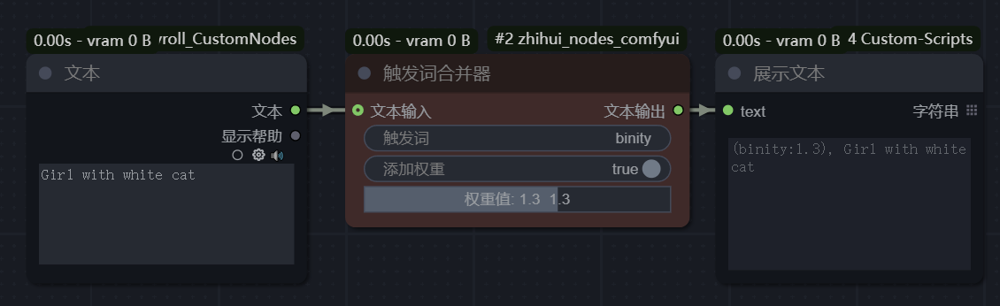
</a>
</div>
</td>
</tr>
<tr>
<td><b>多平台翻译</b><br><code>MultiPlatformTranslate</code></td>
<td>

多平台翻译节点，支持百度、阿里云、有道、智谱AI和谷歌在线共5个平台。用户可以通过配置管理界面设置各平台的API密钥，实现高质量的专业翻译服务。

<b>特点</b>：
- <b>多平台支持</b>：支持主流翻译平台，满足不同需求
- <b>配置管理</b>：通过图形化界面轻松管理各平台API密钥
- <b>专业翻译</b>：提供高质量的专业翻译服务

<div align="left">
<a href="images/Multi Platform Translate.jpg" target="_blank">

</a>
</div>
</td>
</tr>
</table>

### 🎯 提示词处理类节点

<table>
<tr>
<th width="30%">节点名称</th>
<th>功能描述</th>
</tr>
<tr>
<td><b>🏷️TAG标签选择器</b><br><code>TagSelector</code></td>
<td>

新一代智能标签管理系统，集成海量预设标签库、自定义标签功能、角色提取器和内置AI扩写能力，提供前所未有的标签选择体验，快速构建复杂提示词，提升创作效率。

<b>核心功能</b>：
- <b>标签分类丰富：</b>涵盖常规标签、艺术题材、人物属性、场景环境等全方位分类
- <b>自定义标签管理：</b>支持添加、编辑、删除个人专属标签，打造个性化标签库
- <b>智能搜索定位：</b>支持关键词搜索，快速找到目标标签
- <b>实时选择统计：</b>动态显示已选标签数量和详细列表
- <b>随机标签生成：</b>智能随机标签生成功能，支持按分类权重和数量配置自动生成多样化标签组合
- <b>角色提取器：</b>从远程服务器获取角色数据，自动生成AI绘图提示词，支持历史记录管理
- <b>内置AI扩写</b>：一键智能扩写功能，支持标签式和自然语言式两种扩写模式

<b>参数说明</b>：
- <b>tag_edit：</b>手动编辑的标签文本，支持直接输入或粘贴
- <b>random_logic：</b>随机逻辑选择（Disabled/Random Tags/Character Extractor）
  - <b>Disabled：</b>禁用随机功能
  - <b>Random Tags：</b>使用随机标签界面中配置的规则生成标签
  - <b>Character Extractor：</b>使用角色提取器功能获取标签
- <b>expand_mode：</b>扩写模式选择（Disabled/Tag Style/Natural Language/Structured JSON）
- <b>output_language：</b>扩写结果语言（Chinese/English）
- <b>platform：</b>API平台选择（auto自动选择可用平台）
- <b>max_tokens：</b>AI生成内容的最大令牌数

<br>
<div align="left">
<a href="images/Tag Selector1.jpg" target="_blank">

</a>
<a href="images/Tag Selector2.jpg" target="_blank">

</a>
</div>
</td>
</tr>
<tr>
<td><b>提示词卡选择器</b><br><code>PromptCardSelector</code></td>
<td>支持随机/顺序抽取模式、单卡/多卡加载、多种分割方式及卡池洗牌策略，内置卡池管理器提供浏览/搜索/编辑功能，支持导入/导出卡文件，适用于提示词组合与批量管理。

<b>特点</b>：
- <b>双抽取模式</b>：支持随机抽取和顺序抽取两种模式
- <b>多卡加载</b>：支持单卡和多卡加载模式
- <b>灵活分割</b>：支持多种文本分割方式（空白行、换行符等）
- <b>卡池管理</b>：内置卡池管理器，提供浏览、搜索、编辑功能
- <b>导入导出</b>：支持提示卡文件的导入和导出
- <b>洗牌策略</b>：支持卡池洗牌策略，增加随机性

<br>
<div align="left">
<a href="images/Prompt Card Selector1.jpg" target="_blank">

</a>
<a href="images/Prompt Card Selector2.jpg" target="_blank">

</a>
<a href="images/Prompt Card Selector3.jpg" target="_blank">

</a>
</div>
</td>
</tr>
<tr>
<td><b>提示词图库</b><br><code>PromptGallery</code></td>
<td>提示词图库节点：从指定目录加载包含缩略图和文本的图文库，从用户选择的图片输出与图片同名的 <code>.txt</code> 文件内容（提示词文本）。适用于将"图像-提示词"成对管理并在工作流中快速取用。

<br>
<div align="left">
<a href="images/Prompt Gallery.jpg" target="_blank">

</a>
</div>
</td>
</tr>
<tr>
<td><b>提示词预设 - 单选</b><br><code>PromptPresetOneChoice</code></td>
<td>提供6个预设选项，用户可以方便地在不同预设之间切换。适合保存常用的提示词模板，快速应用到不同场景。

<br>
<div align="left">
<a href="images/单选提示词预设.jpg" target="_blank">
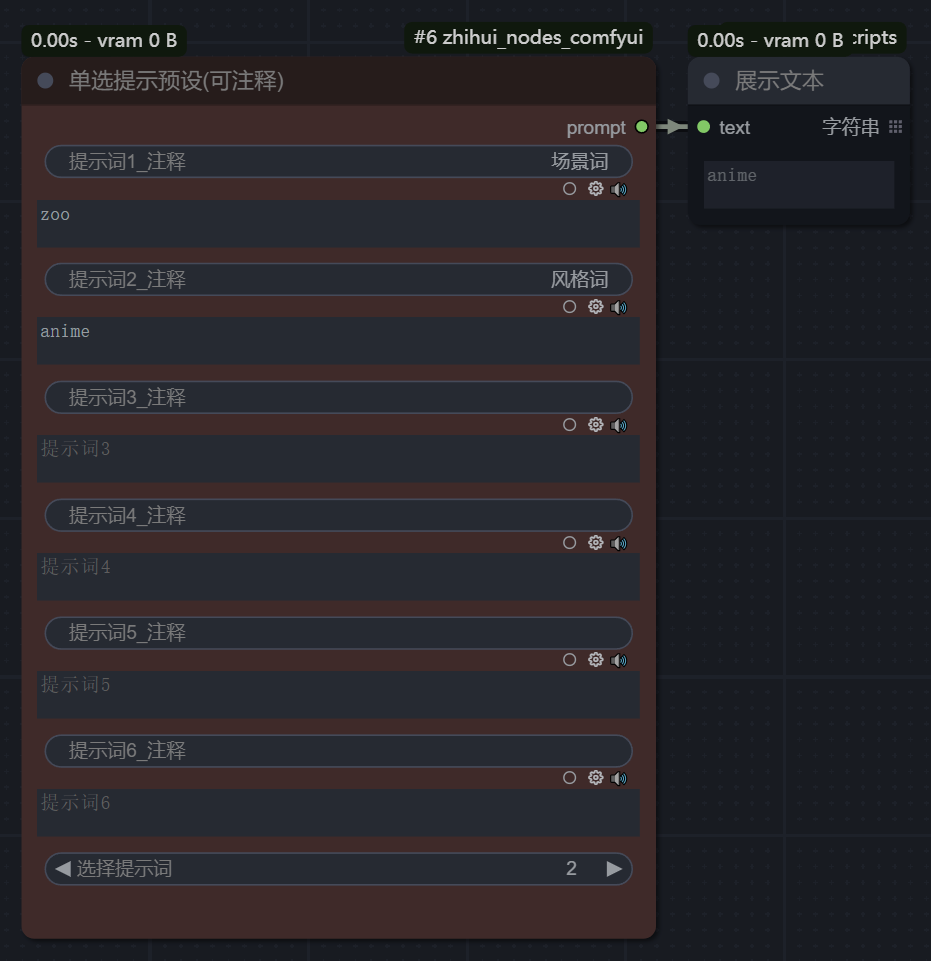
</a>
</div></td>
</tr>
<tr>
<td><b>提示词预设 - 多选</b><br><code>PromptPresetMultipleChoice</code></td>
<td>支持同时选择多个预设，并将它们合并输出，每个预设都带有独立的开关和注释功能。适合构建复杂的组合提示词，灵活控制各部分的启用状态。

<br>
<div align="left">
<a href="images/多选提示词预设.jpg" target="_blank">
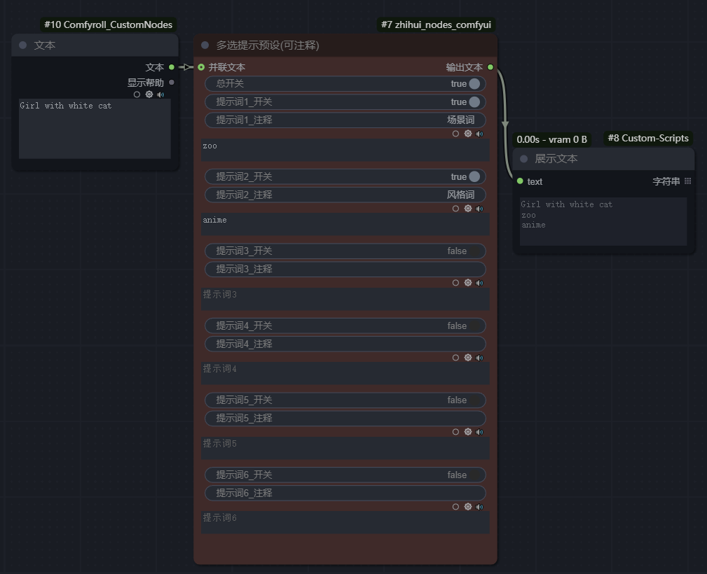
</a>
</div></td>
</tr>
<tr>
<td><b>摄影提示词生成器</b><br><code>PhotographPromptGenerator</code></td>
<td>

根据预设的摄影要素（如相机、镜头、光照、场景等）组合生成专业的摄影风格提示词。

<b>特点</b>：
- 支持从自定义文本文件加载选项，灵活扩展
- 支持随机选择，增加创意多样性
- 输出模板可自定义，适应不同的摄影风格需求

<div align="left">
<a href="images/Photograph Prompt Generator1.jpg" target="_blank">

</a>
<a href="images/Photograph Prompt Generator2.jpg" target="_blank">

</a>
<a href="images/Photograph Prompt Generator3.jpg" target="_blank">

</a>
<a href="images/Photograph Prompt Generator4.jpg" target="_blank">

</a>
</div>
</td>
</tr>
<tr>
<td><b>万相视频提示词生成器</b><br><code>WanPromptGenerator</code></td>
<td>

基于万相2.2官方文档编写的全能型提示词生成器，支持自定义和预设两种组合方法，涵盖运镜、场景、光线、构图等17个维度的专业视频提示词生成。

<b>特点</b>：
- <b>双模式切换</b>：支持自定义组合和预设组合模式，通过开关按钮一键切换
- <b>多维度选择</b>：涵盖主体类型、场景类型、光源类型、光线类型、时间段、景别、构图、镜头焦段、机位角度、镜头类型、色调、运镜方式、人物情绪、运动类型、视觉风格、特效镜头、动作姿势17个专业维度

<div align="left">
<a href="images/万相视频提示词生成器.jpg" target="_blank">
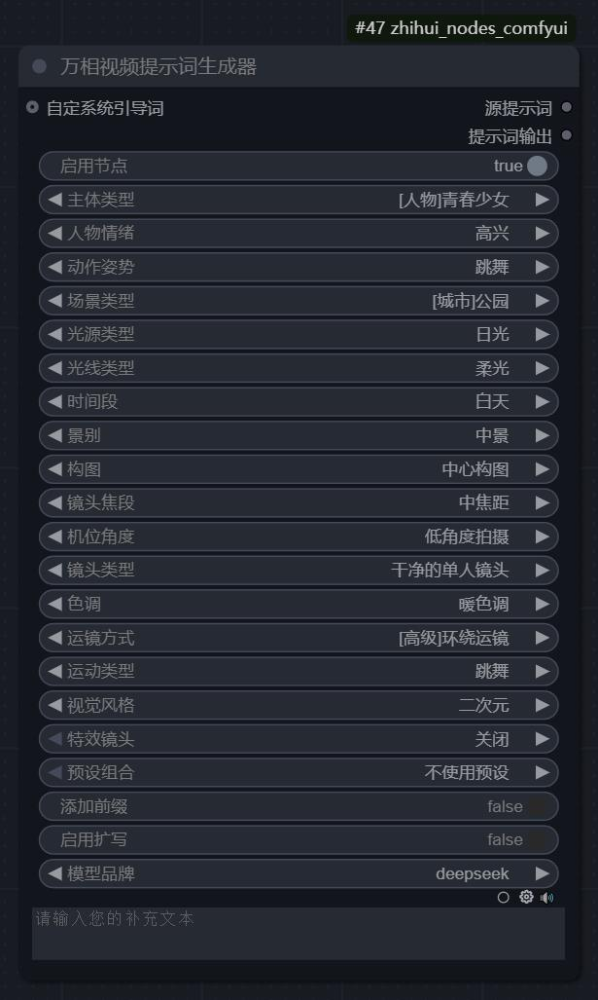
</a>
</div>
</td>
</tr>
<tr>
<td><b>图像编辑预设</b><br><code>ImageEditingPresets</code></td>
<td>提供专业的图像编辑预设库，包含多种专业预设，为图像生成提供风格化指导，帮助用户快速应用常见的艺术风格和效果。</td>
</tr>
<tr>
<td><b>字体设计师</b><br><code>TypeDesigner</code></td>
<td>提供可视化界面，让用户浏览和选择各种字体艺术风格（如3D、霓虹、金属等），自动提供对应的预设提示词，方便进行艺术字创作。

<br>
<div align="left">
<a href="images/Type-Designer1.jpg" target="_blank">
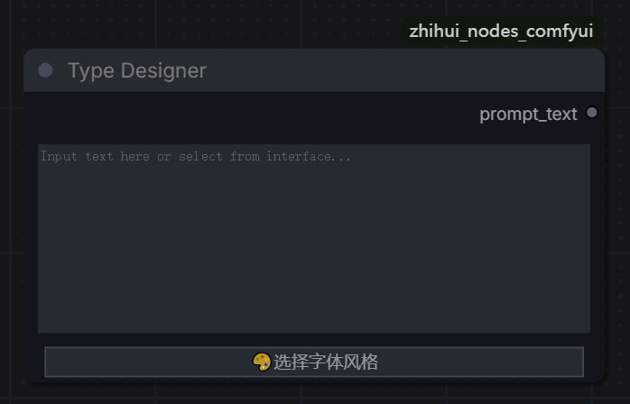
</a>
<a href="images/Type-Designer2.jpg" target="_blank">
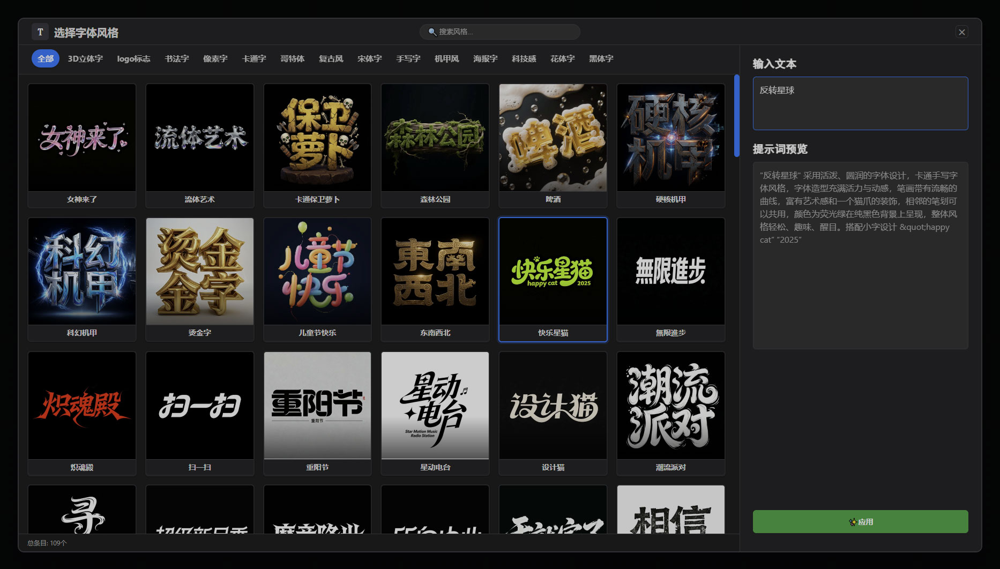
</a>
</div>
</td>
</tr>
</table>

### 🖼️ 图像处理类节点

<table>
<tr>
<th width="30%">节点名称</th>
<th>功能描述</th>
</tr>
<tr>
<td><b>获取图像尺寸</b><br><code>GetImageSizes</code></td>
<td>提取输入图像的宽度和高度信息，并在节点上实时显示尺寸预览。支持多种图像格式输入，提供准确的像素尺寸信息。

<br>
<div align="left">
<a href="images/Get Image Sizes.jpg" target="_blank">

</a>
</div>
</td>
</tr>
<tr>
<td><b>图像宽高比设置</b><br><code>ImageAspectRatio</code></td>
<td>智能图像宽高比设置工具，支持多种预设模式和自定义尺寸配置。

<b>特点</b>：
- <b>多预设支持</b>：内置Qwen、Flux、Flux.2、Flux2 klein、Wan、SDXL、LTX2.3、Z-image、Krea2、MiniMax H3等主流模型的专用宽高比预设
- <b>自定义模式</b>：支持完全自定义的宽度和高度设置
- <b>宽高比锁定</b>：提供宽高比锁定功能，修改一个维度时自动调整另一个维度
- <b>尺寸互换</b>：一键互换宽高数值，方便调整横竖屏方向

<br>
<div align="left">
<a href="images/Image Aspect Ratio1.jpg" target="_blank">

</a>
</div>
<br>
<div align="left">
<a href="images/Image Aspect Ratio2.jpg" target="_blank">

</a>
</div>
</td>
</tr>
<tr>
<td><b>图像缩放器</b><br><code>ImageScaler</code></td>
<td>提供多种插值算法对图像进行缩放，并可选择保持原始宽高比。支持高质量的图像尺寸调整，适用于预处理或后处理阶段。

<br>
<div align="left">
<a href="images/图像缩放器.jpg" target="_blank">
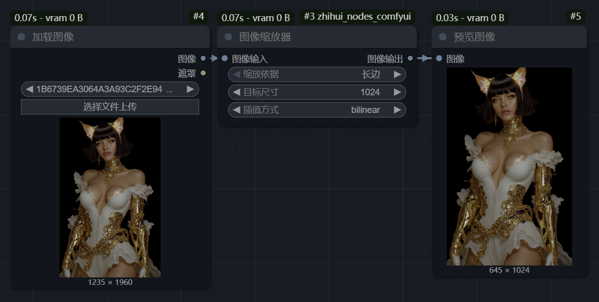
</a>
</div>
</td>
</tr>
<tr>
<td><b>颜色移除</b><br><code>ColorRemoval</code></td>
<td>从图像中移除彩色，输出灰度图像。适用于创建黑白效果或作为特定图像处理流程的预处理步骤。<br><br>
<a href="images/颜色移除节点展示.jpg" target="_blank">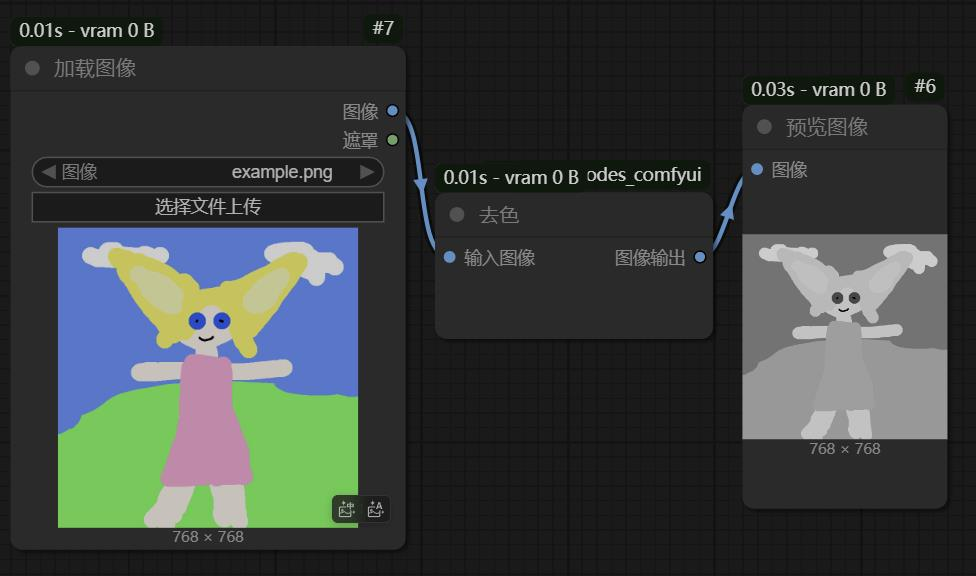</a></td>
</tr>
<tr>
<td><b>图像旋转工具</b><br><code>ImageRotateTool</code></td>
<td>

专业的图像旋转和翻转工具，支持预设角度和自定义角度旋转。

<b>特点</b>：
- <b>预设旋转</b>：提供90°、180°、270°、360°快速旋转选项
- <b>翻转功能</b>：支持垂直翻转和水平翻转操作
- <b>自定义角度</b>：支持-360°到360°范围内的精确角度旋转
- <b>画布处理</b>：可选择扩展画布或裁剪空白两种处理模式
- <b>批量处理</b>：支持批量图像的同时处理

<br>
<div align="left">
<a href="images/Image Rotate Tool.jpg" target="_blank">

</a>
</div>
</td>
</tr>
<tr>
<td><b>图像预览/对比</b><br><code>PreviewOrCompareImages</code></td>
<td>多功能图像预览和对比节点，支持单张图像预览或两张图像的并排对比显示。image_1为必需输入，image_2为可选输入，当提供两张图像时自动启用对比模式。

<b>特点</b>：
- <b>双模式智能切换</b>：根据输入单图或双图自动切换预览或对比模式
- <b>交互式对比</b>：鼠标悬停时显示滑动分割线进行直观对比

<br>
<div align="left">
<a href="images/图像对比.jpg" target="_blank">
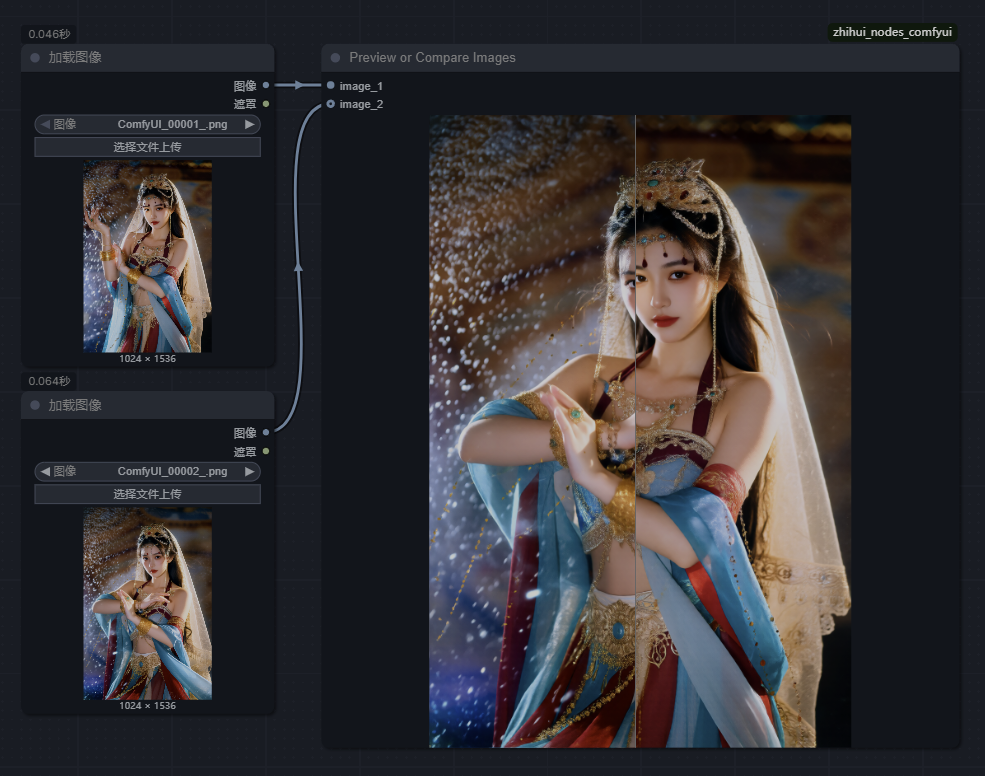
</a>
</div>
</td>
</tr>
<tr>
<td><b>图像格式转换器</b><br><code>ImageFormatConverter</code></td>
<td>

专业的图像格式转换工具，支持批量转换多种图像格式，具备智能格式检测和高级压缩选项。

<b>支持格式</b>：
- <b>输出格式</b>：JPEG、PNG、WEBP、BMP、TIFF
- <b>输入格式</b>：自动检测所有常见图像格式

<b>特点</b>：
- <b>批量处理</b>：支持文件夹批量转换，自动创建输出目录
- <b>质量控制</b>：1-100可调质量参数，精确控制文件大小和画质
- <b>高级选项</b>：支持优化压缩、渐进式编码、无损压缩
- <b>智能检测</b>：基于文件内容而非扩展名的格式检测
- <b>详细报告</b>：提供转换过程的详细信息和统计数据

<br>
<div align="left">
<a href="images/Image Format Converter.jpg" target="_blank">

</a>
</div>
</td>
</tr>
<tr>
<td><b>批量图像加载器</b><br><code>BatchLoadingOfImages</code></td>
<td>

从指定目录批量加载图像文件，支持多种排序方式和加载控制。

<b>特点</b>：
- <b>批量加载</b>：从文件夹批量加载图像，支持JPG、PNG、WEBP、JXL等格式
- <b>多种排序</b>：支持按字母、数字、日期时间等升序/降序排列
- <b>加载控制</b>：支持设置起始索引和加载数量限制
- <b>实时刷新</b>：支持始终重新加载模式，实时获取最新文件

<br>
<div align="left">
<a href="images/BatchLoadingOfImages.jpg" target="_blank">
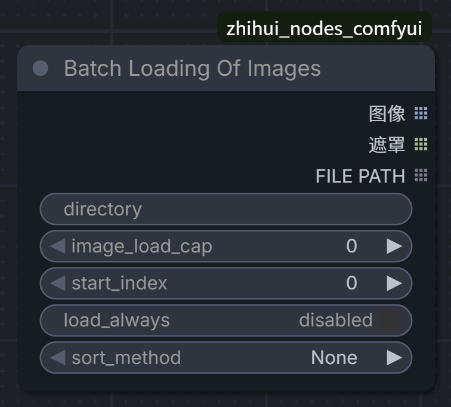
</a>
</div>
</td>
</tr>
<tr>
<td><b>图像编号看板</b><br><code>ImageIndexer</code></td>
<td>
把上游图像按顺序编号为「图1…图N」（英文界面为 Img 1…Img N），并在节点上以带编号的缩略图网格预览，图像本身原样透传、像素不做任何改动。编号顺序与下游多图节点（LM Studio 节点、图像理解在线版）展开图片的顺序一致，适合在写多图提示词时准确指代第几张图。

<b>特点</b>：
- <b>顺序对齐</b>：按下游展开后的单元顺序编号，批量张量会自动逐张拆开计数
- <b>透传输出</b>：输出的图像与输入完全相同，可直接串接在任意下游节点之前
- <b>缩略图预览</b>：点击缩略图打开放大查看器；最多预览前 32 张，超出部分仍照常计数与透传
- <b>改选即预览</b>：上游接多媒体加载器时，改选图片立刻更新缩略图、无需先运行节点（标注「未运行」）；运行后切换为节点实际输出的预览。工作流重新加载时先摆上次运行的结果（高度与存档一致），等你改选再让实时预览接管

</td>
</tr>
<tr>
<td><b>图像切换器(双模式)</b><br><code>ImageSwitchDualMode</code></td>
<td>支持可变数量的图像输入的双模式切换器。通过滑块 <code>inputcount</code> 控制端口数量，并点击按钮 <code>Update inputs</code> 同步增删端口；手动模式下按索引选择输出（<code>select_image</code> 选项随 <code>inputcount</code> 自动更新）；自动模式仅在存在唯一非空输入时输出，检测到多个非空输入将提示错误。新增的图像输入端口均为非必连，便于在不同生成结果或不同处理路径之间进行灵活对比。

<br>
<div align="left">
<a href="images/Image Switch Dual Mode.jpg" target="_blank">

</a>
</div>
</td>
</tr>
<tr>
<td><b>优先级图像切换</b><br><code>PriorityImageSwitch</code></td>
<td>智能优先级图像切换节点，当同时接入图像A和图像B端口时，优先输出B端口的内容；如果B端口无输入，则输出图像A端口的内容；如果两个端口都无输入，则弹出提示要求至少连接一个输入端口。

<b>特点</b>：
- <b>优先级控制</b>：图像B端口优先级高于图像A端口
- <b>智能切换</b>：自动检测输入状态，无缝切换输出，减少手动切换操作

<br>
<div align="left">
<a href="images/优先级图像切换.jpg" target="_blank">
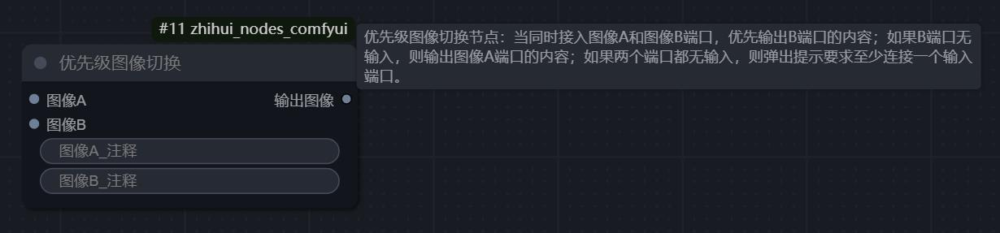
</a>
</div></td>
</tr>
</table>

### 🎞️ 电影后期处理类节点

<table>
<tr>
<th width="30%">节点名称</th>
<th>功能描述</th>
</tr>
<tr>
<td><b>胶片颗粒效果</b><br><code>FilmGrain</code></td>
<td>

为图像添加逼真的胶片颗粒效果，营造经典胶片质感。
- <b>双分布模式</b>：支持高斯分布（自然胶片噪点）和平均分布（数字均匀噪点）
- <b>饱和度混合</b>：独立控制彩色/单色颗粒比例，实现从彩色胶片到黑白胶片的平滑过渡

<br>
<div align="left">
<a href="images/胶片颗粒.jpg" target="_blank">
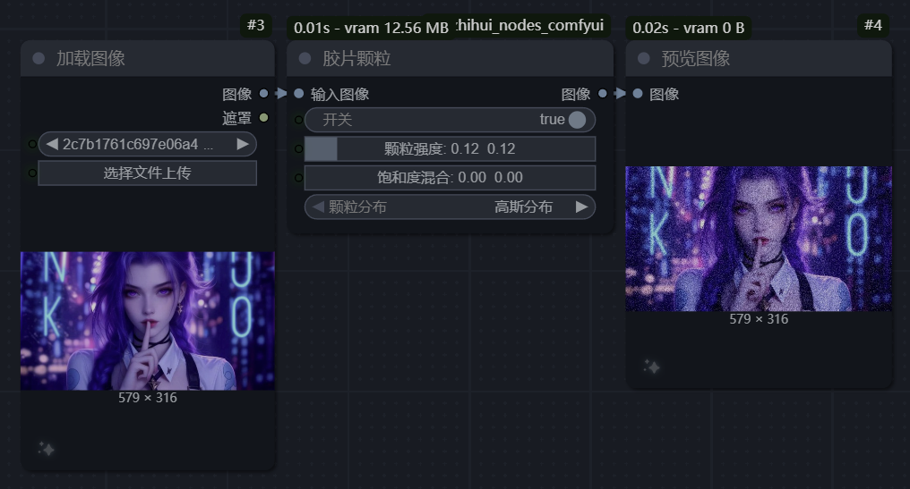
</a>
</div>
</td>
</tr>
<tr>
<td><b>拉普拉斯锐化</b><br><code>LaplacianSharpen</code></td>
<td>
基于拉普拉斯算子的边缘锐化工具，通过二阶微分检测图像边缘并增强细节，适合风景和人像的细节增强。

<br>
<div align="left">
<a href="images/拉普拉斯锐化.jpg" target="_blank">
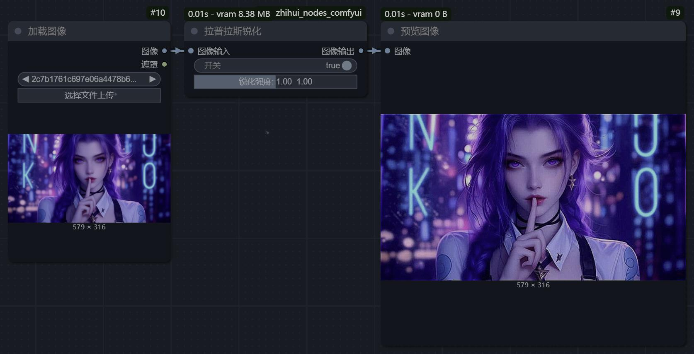
</a>
</div>
</td>
</tr>
<tr>

<td><b>索贝尔锐化</b><br><code>SobelSharpen</code></td>
<td>
采用索贝尔算子的方向性锐化工具，通过梯度计算同时增强水平和垂直边缘，适合需要强调纹理的场景。

<br>
<div align="left">
<a href="images/索贝尔锐化.jpg" target="_blank">
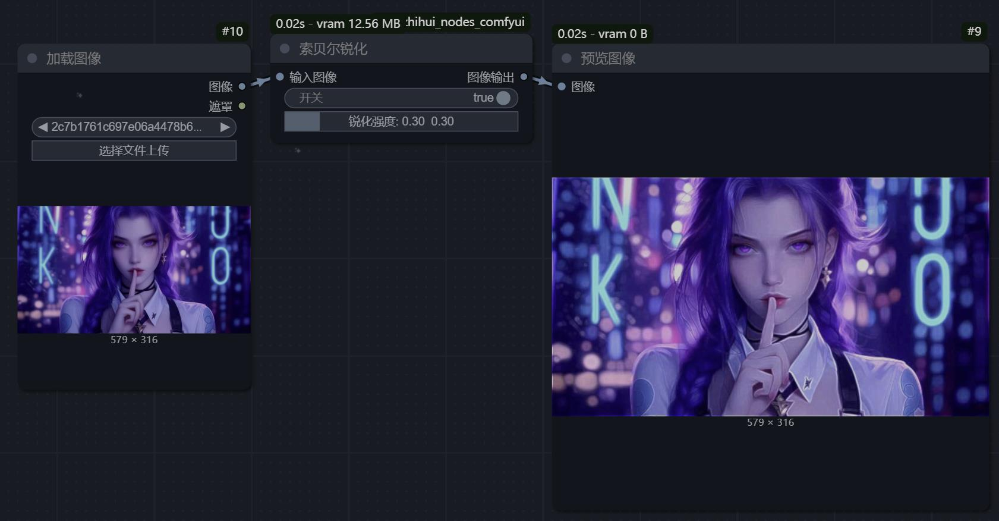
</a>
</div>
</td>
</tr>
<tr>
<td><b>USM锐化</b><br><code>USMSharpen</code></td>
<td>
使用经典USM锐化技术来增强细节，对目标图像进行自然的锐化处理。

<br>
<div align="left">
<a href="images/USM锐化.jpg" target="_blank">
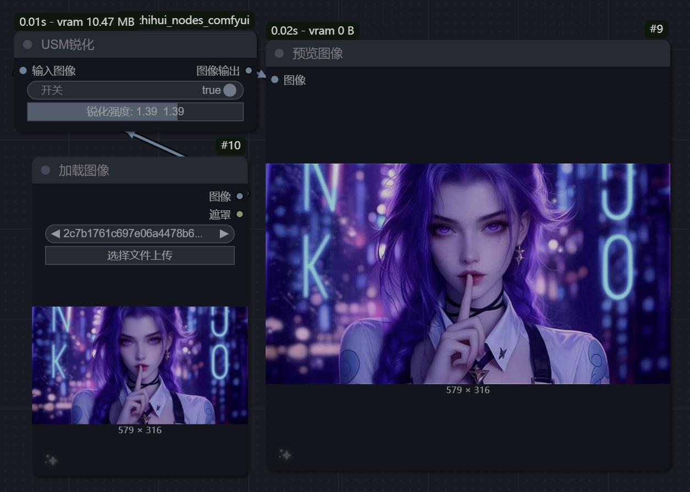
</a>
</div>
</td>
</tr>
<tr>
<td><b>色彩匹配</b><br><code>ColorMatchToReference</code></td>
<td>
智能色彩匹配工具，可将参考图像的色调风格应用到目标图像，实现专业级色彩统一。

<br>
<div align="left">
<a href="images/颜色匹配.jpg" target="_blank">
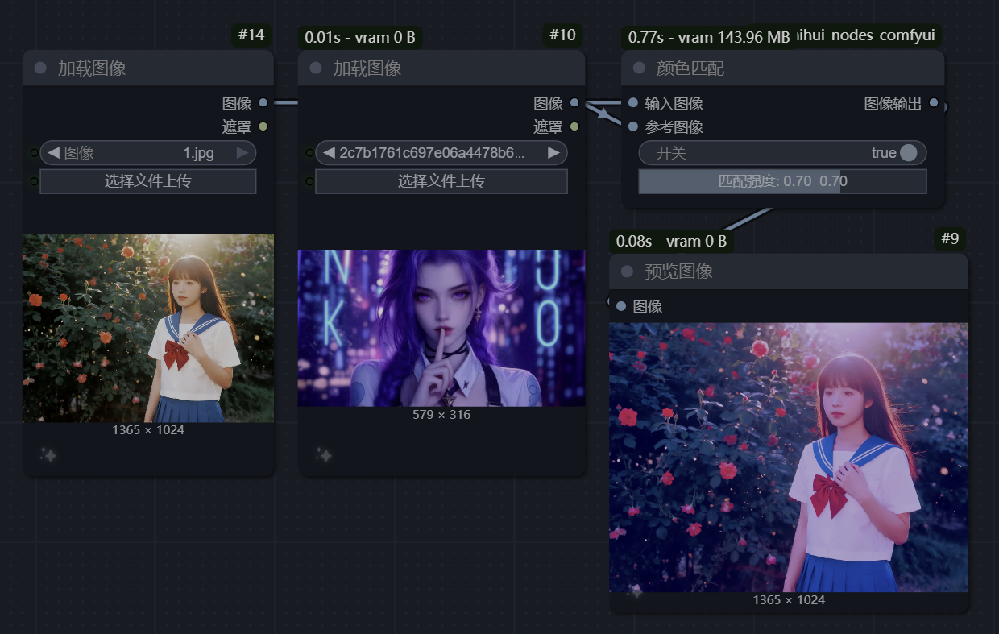
</a>
</div>
</td>
</tr>
</table>

### 🎬 视频处理类节点

<table>
<tr>
<th width="30%">节点名称</th>
<th>功能描述</th>
</tr>
<tr>
<td><b>视频帧提取器</b><br><code>VideoFrameExtractor</code></td>
<td>
专业的视频帧提取工具，支持从视频文件中提取指定数量的帧或按间隔提取帧，适用于视频分析、预览和后续处理。

<b>特点</b>：
- <b>双提取模式</b>：支持按数量提取（均匀分布）和按间隔提取两种模式
- <b>可选保存</b>：支持将提取的帧保存到指定目录

<br>
<div align="left">
<a href="images/Video Frame Extractor.jpg" target="_blank">

</a>
</div>
</td>
</tr>
<tr>
<td><b>视频预览</b><br><code>VideoPreview</code></td>
<td>

接收上游视频并在节点上直接播放，无需先保存到输出目录即可预览结果。

<b>核心功能</b>：
- <b>节点内播放</b>：视频直接在节点面板中播放，省去写入输出目录的步骤
- <b>无损封装</b>：视频仅做无损封装写入 temp 目录，并在多次执行间复用，不解码视频帧
- <b>原样透传</b>：输出端口原样传递视频，可继续接入保存视频等下游节点

</td>
</tr>
</table>

### 🎵 音乐相关节点

<table>
<tr>
<th width="30%">节点名称</th>
<th>功能描述</th>
</tr>
<tr>
<td><b>Suno歌词生成器</b><br><code>SunoLyricsGenerator</code></td>
<td>
把用户描述与主题、歌词语言、演唱编制、歌词风格、情绪、曲风等选项（可随机组合）拼装成一条带 Suno 段落标签格式要求的结构化创作指令，输出给 LLM 节点或 Suno 使用。节点本身完全本地运行，不联网。

<br>
<div align="left">
<a href="images/Lyrics Generator.jpg" target="_blank">

</a>
</div>

</td>
</tr>
<tr>
<td><b>Suno歌曲风格提示词生成器</b><br><code>SunoSongStylePromptGenerator</code></td>
<td>
专业的歌曲风格提示词生成工具，结合用户偏好和音乐元素，生成结构化的Suno风格提示词，用于快速构建风格一致的歌曲。

<br>
<div align="left">
<a href="images/Song Style Prompt Generator.jpg" target="_blank">

</a>
</div>
</td>
</tr>
<tr>
<td><b>音频时长计算器</b><br><code>AudioDuration</code></td>
<td>
计算音频文件的时长信息，输出秒数、格式化时间和毫秒数三种格式。

<b>特点</b>：
- <b>格式化时间</b>：按 HH:MM:SS.mmm 输出，便于直接拼入提示词或文件名
- <b>自动适配</b>：兼容不同维度的音频张量，基于采样率精确计算时长
</td>
</tr>
</table>

### 🧊 潜空间节点

<table>
<tr>
<th width="30%">节点名称</th>
<th>功能描述</th>
</tr>
<tr>
<td><b>Latent切换器(双模式)</b><br><code>LatentSwitchDualMode</code></td>
<td>支持可变数量的潜变量输入的双模式切换器。通过滑块 <code>inputcount</code> 控制端口数量，并点击按钮 <code>Update inputs</code> 同步增删端口；手动模式下按索引选择输出（<code>select_channel</code> 选项随 <code>inputcount</code> 自动更新）；自动模式仅在存在唯一非空输入时输出，检测到多个非空输入将提示错误。新增的潜变量输入端口均为非必连，适合在不同生成路径之间灵活切换与对比实验。

<br>
<div align="left">
<a href="images/Latent Switch Dual Mode.jpg" target="_blank">

</a>
</div>
</td>
</tr>
</table>

### 📦 加载器节点

<table>
<tr>
<th width="30%">节点名称</th>
<th>功能描述</th>
</tr>
<tr>
<td><b>多媒体加载器</b><br><code>MultimediaAdvancedLoader</code></td>
<td>

以缩略图网格管理 `input` 目录中的图片、视频与音频素材，可视化挑选后输出给下游节点。

<b>核心功能</b>：
- <b>三种素材</b>：图片、视频与音频统一在一个网格界面中浏览与选择
- <b>载入模式</b>：默认载入全部素材并输出 MiniMax H3 媒体包端口；切到「仅图片」则隐藏音频与视频，只输出图像端口
- <b>输出方式</b>：支持「点击选中」（仅输出选中项）与「智能编号」（全部按编号顺序输出）
- <b>对接下游</b>：媒体输出可直连 LM Studio 节点与图像理解在线版节点的图像/媒体端口

</td>
</tr>
</table>

### 🤖 AI 助手节点

<table>
<tr>
<th width="30%">节点名称</th>
<th>功能描述</th>
</tr>
<tr>
<td><b>图像理解在线版</b><br><code>ImageUnderstandingOnline</code></td>
<td>
通过 OpenAI 兼容的在线多模态接口进行图像理解的节点，可在通讯配置中预先设置多个平台，并在节点上直接切换。

<b>支持平台</b>：
- <b>任意 OpenAI 兼容接口（自定义配置）</b>

<b>核心特点</b>：
- <b>云端部署</b>：无需本地GPU，通过API调用云端模型
- <b>多平台配置</b>：最多预设 6 套自定义配置，平台切换在节点的下拉菜单中完成
- <b>单图与多图</b>：可接单张图像，也可接图像列表；多张图片会全部合并进同一次请求（与 LM Studio 节点一致），适合差异比对等需要同时看到多图的场景
- <b>文本提示词端口</b>：接入任意字符串输出后，连入的文本替换整个提示词区（预设、用户提示词与系统提示词全部忽略），面板的「提示词」卡片会整张锁定并提示「提示词由文本端口提供」（与 LM Studio 节点一致）
- <b>纯文本可用</b>：不接图像端口时自动作为纯文本节点调用同一平台，提示词与采样参数照常生效
- <b>模板分类</b>：与LM Studio节点共用的提示词模板支持单层分类，可筛选、新建、重命名与删除分类
- <b>批处理</b>：与LM Studio节点同一套批处理能力，只从「批处理路径」的文件夹读取图片，逐张请求并把结果写入图片同名的 <code>.txt</code>；支持「跳过重复」（已存在同名 txt 的图片直接跳过，便于断点续跑）；读取方式可在设置弹窗中切换「递归遍历模式」（一次性遍历所有子文件夹）与「顺序轮次模式」（按文件夹名称顺序依次处理，进度自动记录、中断后可从断点继续）；路径支持拖入文件夹、「设定」按钮选目录或手动输入
</td>
</tr>
<tr>
<td><b>LLM额外选项</b><br><code>LLMExtraOptions</code></td>
<td>
为LLM节点提供详细的输出控制选项，包括人物信息、光照分析、相机角度、水印检测等高级配置参数。

<br>
<div align="left">
<a href="images/LLM额外选项.jpg" target="_blank">
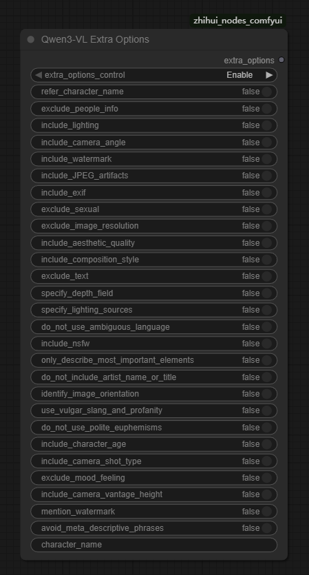
</a>
</div>
</td>
</tr>
<tr>
<td><b>Florence2 Plus</b><br><code>Florence2Plus</code></td>
<td>
基于微软Florence-2视觉理解模型的专业图像分析节点，支持多种任务类型和批量处理功能。

<b>核心特性</b>：
- <b>多模型支持</b>：支持Microsoft Florence-2基础和大型模型，以及MiaoshouAI PromptGen系列
- <b>丰富任务类型</b>：支持标题生成、详细描述、标签生成、混合模式、分析模式等7种任务
- <b>批量处理</b>：支持单张图片、多张图片和整个文件夹的批量处理
- <b>性能优化</b>：支持fp16/bf16/fp32精度，flash_attention_2/sdpa/eager注意力机制
- <b>智能内存管理</b>：提供卸载到CPU、完全卸载、保持加载三种内存管理模式

<b>使用建议</b>：
- 基础任务使用Microsoft模型，复杂任务使用MiaoshouAI PromptGen模型
- 显存充足时使用bf16获得最佳质量，有限时使用fp16平衡性能
- 根据使用频率选择合适的内存管理模式

<br>
<div align="left">
<a href="images/Florence2 Plus1.jpg" target="_blank">

</a>
<a href="images/Florence2 Plus2.jpg" target="_blank">

</a>
</div>
</td>
</tr>
<tr>
<td><b>LM Studio节点</b><br><code>LMStudioNode</code></td>
<td>
连接本地LM Studio服务器的视觉理解节点，支持图像分析和文本生成。通过LM Studio本地部署的大模型，实现无需云端API的私有化图像分析。

<b>前置要求</b>：
- 需要安装 <b>LM Studio</b> 软件，下载地址：[https://lmstudio.ai](https://lmstudio.ai)
- 在LM Studio中下载并加载支持视觉能力的模型（如Qwen2-VL、Llama-Vision等）
- 启动LM Studio的本地服务器功能（默认端口1234）

<b>核心功能</b>：
- <b>本地部署</b>：连接本地LM Studio服务器，无需云端API密钥
- <b>多种预设模板</b>：支持标签反推、详细描述、创意写作等多种提示词预设
- <b>模板分类</b>：提示词模板可按单层分类管理，设置弹窗支持分类筛选、新建、重命名与删除
- <b>输出语言控制</b>：支持中文、英文、中英双语等多种输出语言
- <b>模型自动发现</b>：自动获取LM Studio中已加载的模型列表
- <b>模型刷新</b>：一键刷新按钮，当模型列表显示异常时可重新获取
- <b>多图像输入</b>：画布上只有一个图像端口，接入多媒体加载器的图像输出（图像列表）即合成一次多图推理；接入数量由上游节点决定
- <b>文本提示词端口</b>：接入任意文本输出后，提示词由连线内容提供，整组提示词功能区自动禁用
- <b>模型卸载开关</b>：勾选 <code>unload_model</code> 后，推理结束自动卸载 LM Studio 中已加载的模型，释放显存
- <b>推理日志面板</b>：实时显示推理日志，仅显示当前运行信息
- <b>可视化设置</b>：提供状态设置界面，方便配置参数

<br>
<div align="left">
<a href="images/LM Studio Node.jpg" target="_blank">

</a>
</div>
</td>
</tr>
<tr>
<td><b>系统引导词加载器</b><br><code>SystemPromptLoader</code></td>
<td>从预设文件夹动态加载系统级引导词（System Prompt），并可选择性地与用户输入合并。适合管理和应用复杂的系统提示模板，提高生成结果的一致性和质量。<br><br>
<div align="left">
<a href="images/System Prompt Loader.jpg" target="_blank">

</a>
</div>
</td>
</tr>
</table>

### ⚙️ 工具箱节点

<table>
<tr>
<th width="30%">节点名称</th>
<th>功能描述</th>
</tr>
<tr>
<td><b>资源清理器</b><br><code>ResourceCleaner</code></td>
<td>

系统资源清理工具，提供独立的内存(RAM)、显存(VRAM)和缓存清理控制，可选择性释放系统资源。

<b>特点</b>：
- <b>独立控制</b>：三个清理功能配备独立开关，可单独或组合使用
- <b>详细报告</b>：输出清理过程的详细报告，便于监控资源释放情况

</td>
</tr>
<tr>
<td><b>预留显存设置器</b><br><code>ReservedVRAMSetter</code></td>
<td>

专业的GPU显存预留管理工具，用于控制ComfyUI的显存使用策略，有效防止显存溢出(OOM)错误，提升工作流稳定性。支持手动和自动两种模式，自动模式可根据当前GPU使用情况智能计算合适的预留显存量。

<b>特点</b>：
- <b>双模式支持</b>：手动模式固定设置预留显存量，自动模式根据当前GPU使用情况智能调整
- <b>智能清理</b>：支持在设置前自动清理GPU显存，释放无用资源
- <b>自动限制</b>：自动模式下可设置最大预留上限，防止过度预留影响其他应用
- <b>种子控制</b>：内置随机种子管理，确保工作流的一致性

<br>
<div align="left">

</div>
</td>
</tr>
<tr>
<td><b>释放文本编码器（采样前）</b><br><code>TextEncoderRelease</code></td>
<td>

文本编码器释放工具，在采样前把所连的 CLIP（文本编码器）从显存中卸载，提前腾出显存，适合文本编码器体积大、采样需要完整显存的工作流。

<b>特点</b>：
- <b>执行依赖</b>：条件端口接上编码结果，确保文本编码完成后才卸载编码器
- <b>链路透传</b>：模型端口原样输出，可直接串在采样节点之前
- <b>每次运行</b>：不受节点缓存影响，每个提示词都会执行一次释放
- <b>开关控制</b>：可整体关闭节点，也可静默运行（不打印日志）

</td>
</tr>
<tr>
<td><b>整数节点</b><br><code>IntNode</code></td>
<td>

输出可配置整数值的工具节点，用于统一的参数控制。支持-2147483648到2147483647范围的整数输入，适用于需要精确数值控制的场景。

<br>
<div align="left">
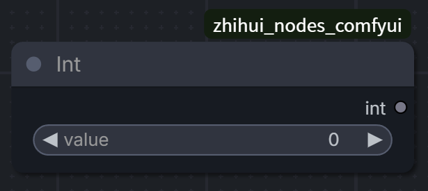
</div>
</td>
</tr>
<tr>
<td><b>组开关管理器</b><br><code>GroupSwitchManager</code></td>
<td>

可视化群组开关管理工具，自动检测工作流中的所有群组，提供一键启用/禁用功能，支持颜色过滤、标题匹配、拖拽排序和群组联动配置。

<b>核心功能</b>：
- <b>智能过滤</b>：支持按颜色或标题关键词筛选群组
- <b>拖拽排序</b>：自定义群组显示顺序
- <b>联动配置</b>：配置群组间的联动规则，实现开关联动效果
- <b>快速导航</b>：点击箭头快速定位到对应群组位置
- <b>双模式支持</b>：支持禁用模式和忽略模式

<br>
<div align="left">
<a href="images/Group Switch Manager1.jpg" target="_blank">

</a>
<a href="images/Group Switch Manager2.jpg" target="_blank">

</a>
<a href="images/Group Switch Manager3.jpg" target="_blank">

</a>
</div>
</td>
</tr>
</table>
---

## 🚀 安装方式

### 📦 方式一：通过 ComfyUI Manager 安装（推荐）

1. 安装 [ComfyUI Manager](https://github.com/ltdrdata/ComfyUI-Manager)
2. 在 Manager 菜单中选择 "Install Custom Nodes"
3. 搜索 `zhiai_nodes_comfyui` 并点击 "Install" 按钮
4. 等待安装完成后重启 ComfyUI，即可在节点菜单中找到新添加的节点

### 🔧 方式二：通过 Git 安装

进入 ComfyUI 的 `custom_nodes` 目录，执行以下命令：

```bash
git clone https://github.com/ZhiHui6/zhiai_nodes_comfyui.git
```

重启 ComfyUI 即可使用。

### 📁 方式三：手动安装

1. 下载本仓库的 ZIP 文件并解压
2. 将整个 `zhiai_nodes_comfyui` 文件夹复制到 ComfyUI 的 `custom_nodes` 目录下
3. 重启 ComfyUI

---

### 🧭 节点菜单位置

安装后所有节点都在右键菜单的 **Zhi.AI** 顶级分类下，按用途分为 Text（文本）、Generator（生成器）、Image（图像）、MovieTools（影视工具）、Video（视频）、Loaders（加载器）、Latent（潜空间）、Toolkit（工具箱）、Audio（音频）、AI Assistant（AI 助手）等子菜单；子菜单名跟随 ComfyUI 界面语言切换，LM Studio、Florence2 等产品名保持原样。新增或更新节点包后需要重启 ComfyUI 才会完成注册。

### 🔑 首次使用配置

- **联网需求**：翻译、AI 扩写、在线图像理解会调用远端接口；文本处理、图像与 Latent 类节点完全本地运行。
- **LLM 平台密钥**：打开 ComfyUI 的「设置」面板 → **ZhiAI** → 点击「📝 API 设置」，即可为 OpenAI、Google、ZhipuAI、DeepSeek、SiliconFlow、MoonshotAI、MiniMax、Alibaba、VolcEngine、Tencent、ModelScope、NVIDIA 以及自定义接口填写 API Key、Base URL 与模型名称，并支持测试连接。标签选择器的 AI 扩写直接读取这套配置（`platform` 选择 auto 时自动挑用可用平台），图像理解在线版的接口配置也与之共用同一份存储。
- **翻译平台密钥**：在「多平台翻译」节点上点击「⚙️ 配置管理」按钮，分别填写百度、阿里云、有道、智谱AI、谷歌在线的密钥。
- **LM Studio**：需要本机运行 LM Studio 并开启本地服务器（默认端口 1234），详见上文该节点的「前置要求」。
- **Florence2 Plus**：首次运行会按所选型号从 HuggingFace 或 ModelScope 下载模型权重，请预留磁盘空间与网络。

### 📋 依赖项

通过 ComfyUI Manager 安装时依赖会自动安装；手动部署时执行：

```bash
pip install -r requirements.txt
```

各依赖的用途如下：

- **opencv-python**：颜色移除、图像旋转工具、视频帧提取器、LM Studio 节点
- **scikit-image**：色彩匹配
- **transformers / huggingface_hub / modelscope / timm / einops**：Florence2 Plus
- **openai**：图像理解在线版
- **nvidia-ml-py**：预留显存设置器（需要 NVIDIA 驱动）
- **cryptography**：标签选择器角色提取器内置数据的解密读取

## 📄 许可证

本项目基于 **GPL-3.0** 许可证开源，完整条款见 [LICENSE](LICENSE)。

## 🤝 贡献指南

我们欢迎各种形式的贡献：

- 🐛 [报告问题](https://github.com/ZhiHui6/zhiai_nodes_comfyui/issues/new?labels=bug)
- 💡 [提出功能建议](https://github.com/ZhiHui6/zhiai_nodes_comfyui/issues/new?labels=enhancement)
- 📚 改进文档、💻 提交代码：直接开 [Pull Request](https://github.com/ZhiHui6/zhiai_nodes_comfyui/compare)

如果您有任何想法或建议，请随时提出 Issue 或 Pull Request。
